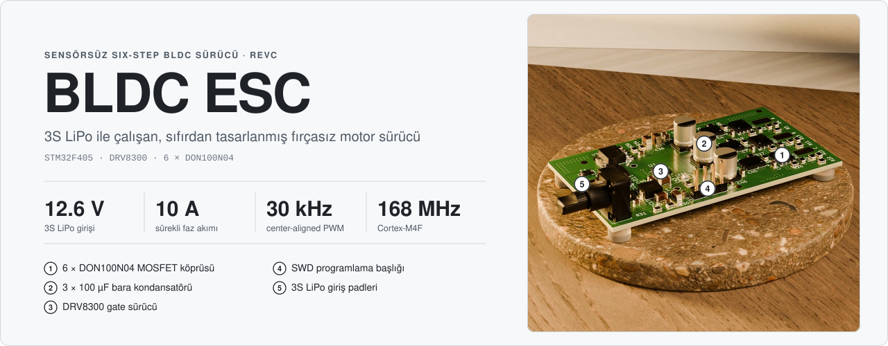
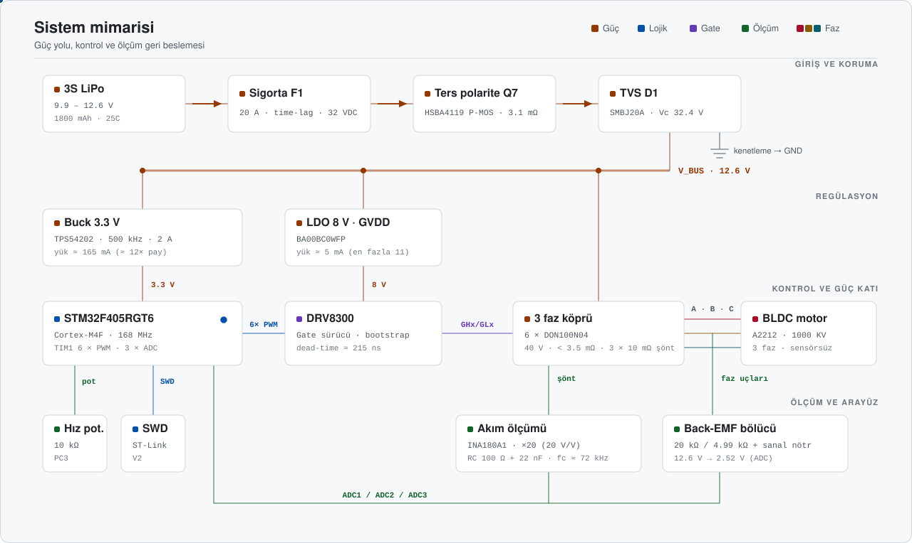
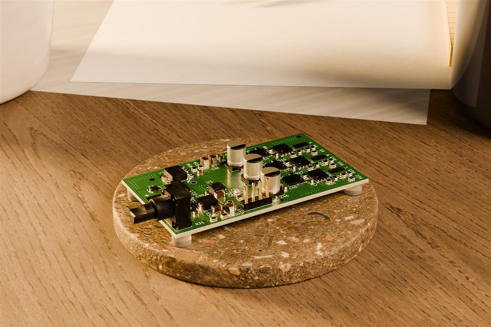
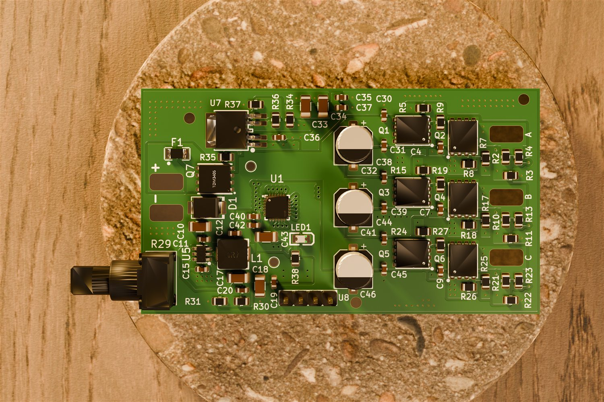
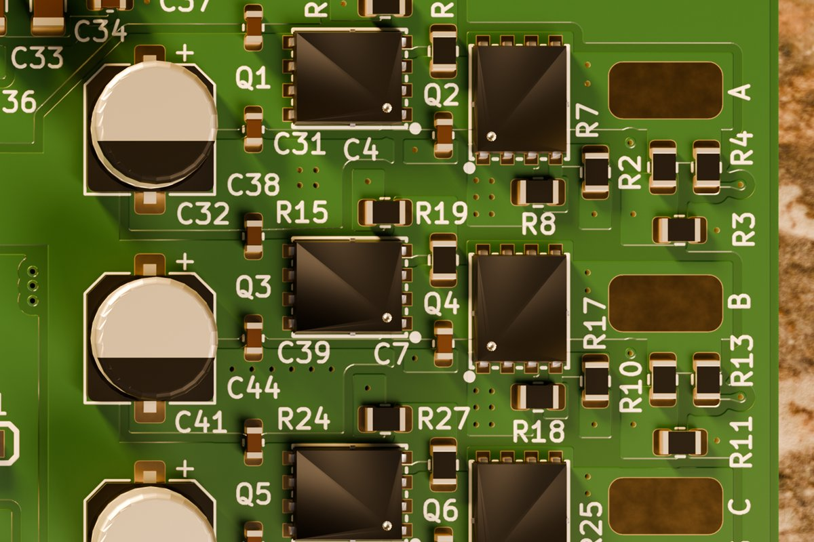
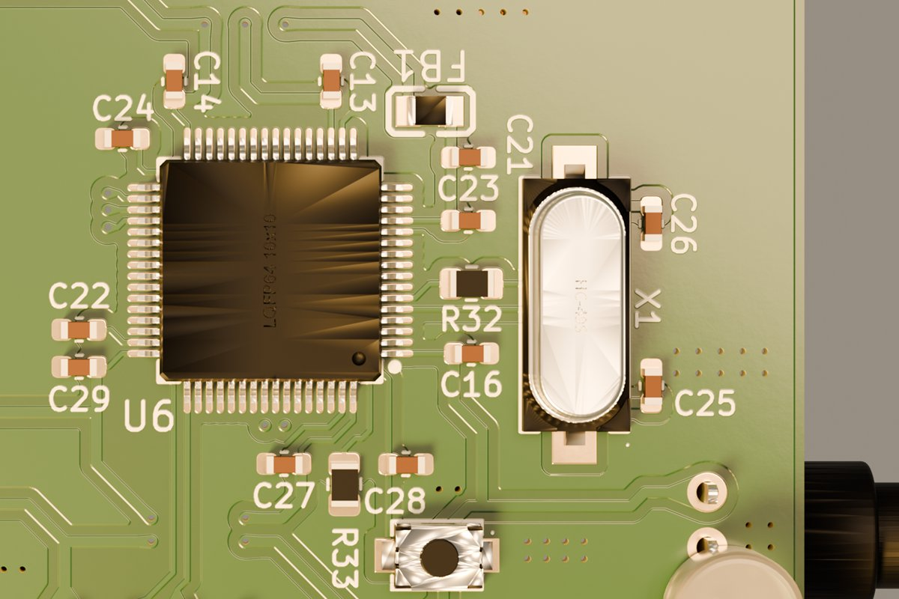
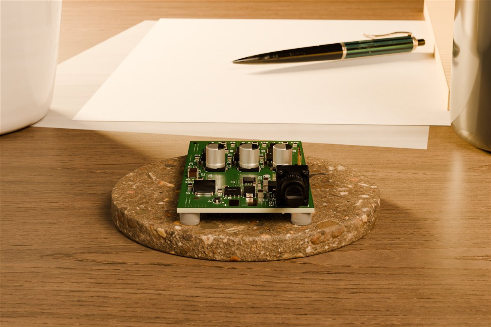

<div align="center">



<br/>

<a href="#-donanım"></a>
<a href="#-donanım"></a>
<a href="#-pcb"></a>


<br/><br/>

**Sıfırdan tasarlanmış bir fırçasız DC (BLDC) motor sürücüsü.**<br/>
Hall sensörü olmadan, boştaki fazın back-EMF sıfır geçişini okuyarak rotor konumunu tahmin eder.

<br/>

<a href="assets/pcb-render.mp4">
  
</a>

<sub>PCB'nin Blender'da hazırlanmış 3D render'ı · tam çözünürlüklü video için görsele tıklayın</sub>

</div>

<!--
  ────────────────────────────────────────────────────────────────────────────
  OYNATILABİLİR VİDEO (isteğe bağlı)
  GitHub, repodaki .mp4 dosyalarını README içinde oynatıcı olarak GÖSTERMEZ.
  Oynatıcı istiyorsanız:
    1) GitHub'da README.md'yi web editöründe açın (kalem simgesi).
    2) assets/pcb-render.mp4 dosyasını editöre sürükleyip bırakın.
    3) Oluşan https://github.com/user-attachments/assets/... satırını
       aşağıdaki "VIDEO_LINKI_BURAYA" satırının yerine koyun (tek başına, kendi satırında).
    4) Bu yorum bloğunu silebilirsiniz.
  ────────────────────────────────────────────────────────────────────────────
-->

<!-- VIDEO_LINKI_BURAYA -->


## İçindekiler

- [Genel bakış](#-genel-bakış)
- [Öne çıkanlar](#-öne-çıkanlar)
- [Sistem mimarisi](#-sistem-mimarisi)
- [Six-step komütasyon](#-six-step-komütasyon)
- [Donanım](#-donanım)
- [Tasarım hesapları](#-tasarım-hesapları)
- [Pin haritası](#-pin-haritası)
- [PCB](#-pcb)
- [Firmware gereksinimleri](#-firmware-gereksinimleri)
- [Malzeme listesi](#-malzeme-listesi)
- [Depo yapısı](#-depo-yapısı)

## ◆ Genel bakış

Bu proje, bir **A2212 1000 KV** fırçasız motoru **3S LiPo** batarya ile sürmek için tasarlanmış bir ESC'dir (Electronic Speed Controller). Kart; güç girişi koruması, iki ayrı regülatör, 3 fazlı MOSFET köprüsü, faz başına bağımsız akım ölçümü, back-EMF algılama ve bir **STM32F405** mikrodenetleyiciyi tek bir PCB üzerinde topluyor.

Tasarımdaki her değer bir hesaba dayanıyor: MOSFET seçiminden bootstrap kondansatörüne, dead-time'dan ferrit bead bastırma oranına kadar kararların gerekçesi [Tasarım hesapları](#-tasarım-hesapları) bölümünde; tüm türetimler adım adım [Hesaplama Notları](Tactical%20Calculation%20Reports.pdf) dosyasında.

| Özellik | Değer |
|---|---|
| **Kontrol yöntemi** | Sensörsüz six-step (trapezoidal), back-EMF sıfır geçişi |
| **Giriş gerilimi** | 3S LiPo · 11.1 V nominal · 12.6 V maksimum |
| **Faz akımı** | 10 A sürekli · 12 A tepe (tasarım hedefi) |
| **Anahtarlama** | 30 kHz, center-aligned PWM |
| **Dead-time** | 2 katman: TIM1 DTG ≈ 1 µs + DRV8300 sabit ≈ 215 ns (tipik) |
| **Akım ölçümü** | 3 × low-side şönt (10 mΩ) + 3 × INA180A1 (20 V/V), eşzamanlı örnekleme |
| **Hız ayarı** | Panel montaj 10 kΩ potansiyometre |
| **Programlama** | SWD (ST-Link V2) |

## ◆ Öne çıkanlar

<table>
<tr>
<td width="50%" valign="top">

**Katmanlı giriş koruması**<br/>
TVS diyot (SMBJ20A, 32.4 V clamp), 20 A SMD sigorta ve P-kanal ters polarite MOSFET. Hot-plug ve anahtarlama kaynaklı gerilim darbelerine karşı koruma.

</td>
<td width="50%" valign="top">

**Faz başına eşzamanlı akım ölçümü**<br/>
Üç şönt akımı üç ayrı ADC'ye dağıtıldı (ADC1/2/3) ve her birinde **Rank 1** kanalı. TIM1 CH4 tetiklediği anda üç faz aynı anda örnekleniyor, fazlar arası zaman kayması yok.

</td>
</tr>
<tr>
<td valign="top">

**Isıl hesabı yapılmış MOSFET seçimi**<br/>
DON100N04 (40 V, < 3.5 mΩ, **Q<sub>g</sub> ≈ 40 nC** @ 10 V). 10.5 A'de MOSFET başına ≈ 0.39 W (25 °C); sıcakken (4.46 mΩ) ≈ 0.49 W ve 40 °C ortamda T<sub>J</sub> ≈ 65 °C. Bu kartta tek MOSFET'in ısıl sınırı ≈ 22 A.

</td>
<td valign="top">

**Temiz analog besleme**<br/>
VDDA hattı ferrit bead + 100 nF + 1 µF ile buck ripple'ından ayrıldı. 500 kHz'de tahmini **30–60 kat bastırma** (geçen kısım ≈ %1.6–3). ADC referansı ve CSA beslemesi aynı hattan: ölçüm oransal (ratiometric).

</td>
</tr>
<tr>
<td valign="top">

**Hesaplanmış bootstrap**<br/>
C<sub>BOOT,min</sub> ≈ 47 nF (TI'ın 1 V dalgalanma kuralı), seçilen 100 nF ile **~2× pay** ve ≈ 0.47 V dalgalanma. Üst kol kesintisiz açık kalamayacağı için %100 duty kullanılmıyor.

</td>
<td valign="top">

**Sanal nötr ile back-EMF algılama**<br/>
Faz başına 20 kΩ / 4.99 kΩ bölücü 12.6 V'u ≈ 2.52 V'a indiriyor; 3 × 20 kΩ + 1.65 kΩ'luk sanal nötr aynı ölçekte (sapma ≈ %0.7). Boştaki fazın nötrü kestiği an sıfır geçişi.

</td>
</tr>
</table>

## ◆ Sistem mimarisi

<p align="center">
  
</p>

Güç yolu soldan sağa akıyor: batarya, sırasıyla sigorta (F1) ve ters polarite MOSFET'inden (Q7) geçip `V_BUS` barasına ulaşıyor; TVS diyodu (D1) Q7'nin hemen arkasında, bara ile GND arasındadır. Bu baradan üç kol ayrılıyor:

- **TPS54202 buck** → 3.3 V (MCU, CSA'lar, potansiyometre) · 500 kHz senkron
- **BA00BC0WFP LDO** → 8 V GVDD (DRV8300 gate sürme beslemesi) · ≈ 5 mA tipik, en fazla ≈ 11 mA yük
- **3 faz köprü** → motor fazları A / B / C

STM32, TIM1'in 6 tamamlayıcı PWM çıkışıyla DRV8300'ü sürüyor; DRV8300 de bootstrap üzerinden üst kol N-kanal MOSFET'lerin gate'lerini bara geriliminin üstüne taşıyor.

## ◆ Six-step komütasyon

<p align="center">
  
</p>

Her elektriksel periyot altı adıma bölünüyor. Her adımda **iki faz aktif** (biri üst koldan PWM'leniyor, diğeri alt koldan sürekli iletimde), **üçüncü faz boşta** kalıyor. Boştaki fazın back-EMF'i sanal nötr seviyesini kestiği anda (sıfır geçişi) rotorun konumu biliniyor ve bir sonraki adıma geçiş zamanlanıyor.

| Adım | 1 | 2 | 3 | 4 | 5 | 6 |
|:--|:-:|:-:|:-:|:-:|:-:|:-:|
| **Üst kol (PWM)** | A | A | B | B | C | C |
| **Alt kol (açık)** | B | C | C | A | A | B |
| **Boşta (BEMF ölçümü)** | C | B | A | C | B | A |

> [!NOTE]
> Motor dururken back-EMF olmadığı için sensörsüz kontrolde **açık döngü başlatma** (open-loop ramp) gerekiyor. Motor yeterli hıza ulaşıp BEMF okunabilir hale geldiğinde kapalı döngüye geçiliyor.

## ◆ Donanım

<details open>
<summary><b>Güç katı</b></summary>
<br/>

| Blok | Parça | Not |
|---|---|---|
| Yarım köprü MOSFET'leri | 6 × **DON100N04** (DFN-8) | 40 V · < 3.5 mΩ · Q<sub>g</sub> ≈ 40 nC · gövde diyodu yeterli, harici Schottky yok |
| Gate dirençleri | 6 × 15 Ω | TI referans tasarımı ve bağımsız hesapla doğrulandı |
| Gate pull-down | 6 × 10 kΩ | Self turn-on koruması |
| Faz kondansatörleri | Faz başına 100 µF + 1 µF + 100 nF | Bulk + decoupling |

</details>

<details>
<summary><b>Gate sürücü — DRV8300</b></summary>
<br/>

- DT pini boşta (ya da GND'de): dahili dead-time ≈ 215 ns (tipik, datasheet)
- Bootstrap: 100 nF, entegre bootstrap diyodu
- GVDD: 8 V LDO çıkışı
- nFAULT çıkışı yok → donanımsal aşırı akım kesmesi (BKIN) yok; akım, şönt + INA180 zinciriyle ölçülüyor

</details>

<details>
<summary><b>Akım ölçümü</b></summary>
<br/>

- 3 × **10 mΩ / 3 W** şönt (2512), alt kol altında (low-side)
- 3 × **INA180A1** (20 V/V) — 12 A'de 2.4 V çıkış
- Çıkışta 100 Ω + 22 nF RC filtre (f<sub>c</sub> ≈ 72 kHz)
- 12-bit ADC ile çözünürlük ≈ **4 mA / LSB**

</details>

<details>
<summary><b>Back-EMF algılama</b></summary>
<br/>

- Faz başına bölücü: 20 kΩ / 4.99 kΩ → 12.6 V faz geriliminde **≈ 2.52 V** ADC girişi
- Sanal nötr: 3 × 20 kΩ yıldız + 1.65 kΩ (R<sub>n</sub> = R<sub>alt</sub>/3) → faz bölücüleriyle aynı ölçek
- Tüm dirençler ±%1; ölçek sapması ≈ %0.7

</details>

<details>
<summary><b>Mikrodenetleyici — STM32F405RGT6</b></summary>
<br/>

- Cortex-M4F · 168 MHz · 1 MB Flash · 192 KB RAM · FPU
- 8 MHz HSE kristal, 2 × 30 pF yük kondansatörü (C<sub>L</sub> = 20 pF)
- VCAP1/2: 2 × 2.2 µF X5R
- 4 × VDD'ye ayrı 100 nF, VBAT → 3.3 V + 100 nF
- NRST: 100 nF + tact switch · BOOT0: 10 kΩ ile GND
- SWD: 4 pinlik 2.54 mm header (3.3 V, SWDIO, SWCLK, GND)

</details>

<details>
<summary><b>Göstergeler (LED)</b></summary>
<br/>

| LED | Görev | Sürüş | Akım |
|---|---|---|---|
| LED1 | Güç göstergesi | 3.3 V → R38 (200 Ω) → LED1 → GND | ≈ 6.5 mA |
| LED2 | SWD aktivite göstergesi | 3.3 V → R39 (200 Ω) → LED2 → Q8 (MMBT5551, low-side) · baz SWCLK'ten R40 (10 kΩ) ile | ≈ 6.5 mA |

- LED2, debugger bağlıyken SWCLK üzerindeki trafikle yanıp söner; MCU pini harcamaz.
- Q8'in baz akımı ≈ 0.26 mA — SWCLK hattını anlamlı ölçüde yüklemez.

</details>

## ◆ Tasarım hesapları

<details>
<summary><b>Giriş koruması: sigorta, ters polarite MOSFET'i, TVS</b></summary>
<br/>

**Sigorta (F1).** 20 A, gecikmeli (time-lag), 32 V DC. Gecikmeli olması motorun kalkış anındaki kısa süreli yüksek akımda gereksiz atmayı önler; 20 A, 10 A'lik çalışma akımının iki katıdır.

**Ters polarite MOSFET'i (Q7).** Kayıp karşılaştırması, R<sub>DS(on)</sub> = 3.1 mΩ ile:

$$\text{Q7 ile: } P = I^2 \times R_{DS(on)} = 10^2 \times 0.0031 \approx 0.31\text{ W}$$

$$\text{Schottky diyotla: } P = V_F \times I \approx 0.45\text{ V} \times 10\text{ A} \approx 4.5\text{ W}$$

Fark yaklaşık 15 kattır. Q7'nin gate–source arasına en fazla 12.6 V gelir; HSBA4119'un V<sub>GS</sub> sınırı ±20 V, V<sub>DS</sub> sınırı −40 V'tur.

**TVS (D1, SMBJ20A).** 20 V'a kadar neredeyse hiç akım çekmez; darbeyi en fazla 32.4 V'ta kenetler (V<sub>BR</sub> = 22.2–24.5 V, I<sub>PP</sub> = 18.6 A'de V<sub>C</sub> = 32.4 V). Bu değer 40 V'luk MOSFET'lerin altında kaldığı için onları korur; ama bataryadan doğrudan beslenen BA00BC0WFP (girişi en fazla 18 V) ve TPS54202 (en fazla 30 V) bu seviyede tam korunmaz. 3S'te normal gerilim 12.6 V olduğundan bu yalnızca ciddi bir darbede söz konusudur.

**Ters bağlantıda D1.** D1 tek yönlü bir TVS'tir ve şemada Q7'nin arkasında, bara tarafındadır. Ters bağlantıda Q7 kapalı kalır ve gövde diyodu ters kutuplanır; bara, D1 dahil, bataryadan ayrılır. Bu yüzden D1 iletime geçmez, F1 atmaz ve kart zarar görmez.

</details>

<details>
<summary><b>MOSFET seçimi</b></summary>
<br/>

Anahtarlama anında akım bir MOSFET'ten diğerine devredilirken yoldaki parazit endüktans aşım üretir:

$$\Delta V \approx L_{\text{parazit}} \times \frac{di}{dt} \qquad\text{(örnek: } 10\text{ nH} \times 0.5\text{ A/ns} = 5\text{ V)}$$

Bu yüzden pratikte bara geriliminin en az 2 katı alınır:

$$V_{DS} \geq 2 \times V_{\text{bara,max}} = 2 \times 12.6\text{ V} = 25.2\text{ V} \quad\Rightarrow\quad 40\text{ V sınıfı}$$

$$I_D \geq 3 \times I_{\text{çalışma}} = 3 \times 10\text{ A} = 30\text{ A} \quad\Rightarrow\quad \text{DON100N04: 100 A}$$

İletim kaybı, 25 °C'de $R_{DS(on)} \leq 3.5\text{ m}\Omega$ ile:

$$P = I^2 \times R_{DS(on)} = 10.5^2 \times 0.0035 \approx 0.39\text{ W}$$

Asıl karar ısıl hesapla verilir. Datasheet'teki 100 A (T<sub>C</sub> = 25 °C) ve 59 A (T<sub>C</sub> = 125 °C) değerleri, sonsuz soğutucu varsayımıyla (R<sub>θCA</sub> = 0) yapılmış ısı hesabıdır: $P_{max} = 25/1.6 \approx 15.6\text{ W}$, $I_D = \sqrt{15.6/0.00446} \approx 59\text{ A}$. Bu kartta soğutucu yoktur; ısı PCB bakırından havaya atılır. Sıcakken (150 °C) direnç ≈ 4.46 mΩ, R<sub>θJA</sub> = 50 °C/W ve T<sub>A</sub> = 40 °C ile:

$$P = 10.5^2 \times 0.00446 \approx 0.49\text{ W} \quad\Rightarrow\quad T_J = T_A + P \times R_{\theta JA} = 40 + 0.49 \times 50 \approx 65\text{ °C}$$

$$I_{max} = \sqrt{\frac{(150 - 40)/50}{0.00446}} = \sqrt{\frac{2.2\text{ W}}{0.00446\ \Omega}} \approx 22\text{ A}$$

Yani bu kartta tek bir MOSFET'in sürekli taşıyabileceği akım datasheet'teki 100 A değil, yaklaşık 22 A'dir. Datasheet'teki en kötü parça (25 °C'de 3.5 mΩ, tipikten ≈ 1.25 kat dirençli) için P ≈ 0.61 W ve T<sub>J</sub> ≈ 71 °C olur; sonuç değişmez. Six-step'te bir MOSFET bir elektriksel turun yalnızca bir kısmında akım taşıdığı için gerçek ortalama ısı bundan da düşüktür.

</details>

<details>
<summary><b>Bara kondansatörleri</b></summary>
<br/>

Üst MOSFET her açıldığında motor akımı (≈ 10 A) bir anda bu kola akmak ister; batarya kablo ve PCB izlerinin endüktansı yüzünden bu ani talebe yetişemez. Bu yüzden her kolun yanına faz başına 100 µF + 1 µF + 100 nF konur: 100 µF'lık elektrolitik yükün büyük kısmını depolar, 1 µF ve 100 nF'lık seramikler MHz mertebesindeki hızlı akım değişimlerini karşılar. Kondansatörlerin MOSFET'lerin dibinde olması hızlı akım döngüsünü kısaltır, aşımı azaltır. Motor sargısı bu döngünün içinde değildir; endüktansı büyük olduğu için anahtarlama süresince sabit bir akım kaynağı gibi davranır.

</details>

<details>
<summary><b>Gate sürme: neden sürücü, gate direnci, tepe ve ortalama akım</b></summary>
<br/>

STM32 MOSFET'leri doğrudan süremez:

1. **Gerilim yetmez:** pin en fazla 3.3 V verir; MOSFET'in R<sub>DS(on)</sub> değeri 4.5 V ve 10 V için verilmiştir.
2. **Akım yetmez:** 40 nC'luk gate'i bir GPIO'nun 25 mA'iyle doldurmak $t \approx Q_g / I = 40\text{ nC} / 25\text{ mA} \approx 1.6\ \mu\text{s}$ sürer; DRV8300'ün 0.75 A'iyle aynı süre ≈ 53 ns'dir.
3. **Üst MOSFET'in gate'i baranın üstüne çıkmalı:** source 12.6 V'a çıkınca gate ≈ 20 V civarında olmalıdır; bunu sürücü bootstrap devresiyle üretir.

15 Ω seri gate direnci gate'in dolma hızını yumuşatır (di/dt ve aşım düşer) ve sürücünün tepe akımını sınırlar; daha büyük direnç daha yumuşak ama daha yavaş (daha sıcak) anahtarlama demektir. 10 kΩ pull-down gate'i source seviyesinde tutar.

$$I_{\text{tepe}} = \frac{V_{GVDD}}{R_{toplam}} = \frac{8\text{ V}}{15\ \Omega} \approx 0.53\text{ A}$$

Sürücünün ve MOSFET'in iç dirençleri eklendiği için gerçek tepe akım bunun biraz altında kalır; DRV8300'ün 750 mA'lik (tipik) açma ve 1.5 A'lik kapama akımının altındadır.

$$I_{\text{ort}} \approx \frac{I_{\text{tepe}}}{2} = \frac{0.53}{2} \approx 0.27\text{ A} \qquad t_{\text{şarj}} \approx \frac{Q_g}{I_{\text{ort}}} = \frac{32\text{ nC}}{0.27\text{ A}} \approx 120\text{ ns}$$

120 ns, 30 kHz'lik PWM periyodunun (33 µs) binde dördü kadardır. Gate 8 V ile sürüldüğü için taşınan yük ≈ 32 nC'dur; hesaplarda 40 nC kullanmak güvenli taraftır.

</details>

<details>
<summary><b>Bootstrap kondansatörü</b></summary>
<br/>

Üst kol MOSFET'ini iletimde tutmak için gate'in source'un 8 V üstünde olması gerekir; source bara gerilimine (12.6 V) fırladığı için gate sabit 8 V ile sürülemez. Gate, SH ile birlikte yükselip alçalan bir kondansatörden (C<sub>boot</sub>) beslenir:

- **Şarj fazı:** alt MOSFET iletimdeyken SH ≈ 0 V; GVDD, DRV8300 içindeki bootstrap diyodu üzerinden kondansatörü doldurur. Diyot düşümü (en fazla 0.85 V) yüzünden kondansatörde 8 − 0.85 ≈ 7.15 V birikir.
- **Sürüş fazı:** üst MOSFET iletime geçer, SH 12.6 V'a çıkar; kondansatörün üst ucu 12.6 + 7.15 ≈ 19.8 V'ta kalır ve gate bu noktadan beslenir.

Kondansatörün boyutu (TI'ın yöntemiyle, V<sub>GVDD</sub> = 8 V, Q<sub>g</sub> = 40 nC, f<sub>sw</sub> = 30 kHz):

$$\Delta V_{BST} = V_{GVDD} - V_{BOOTD} - V_{BSTUV} = 8 - 0.85 - 4.5 = 2.65\text{ V}$$

$$Q_{tot} = Q_g + \frac{I_{LBS,TRAN}}{f_{sw}} = 40\text{ nC} + \frac{220\ \mu\text{A}}{30\text{ kHz}} \approx 47\text{ nC}$$

TI, kondansatör üzerindeki çevrim başına dalgalanmanın 1 V'u geçmemesini öneriyor:

$$C_{BOOT,min} = \frac{Q_{tot}}{1\text{ V}} \approx 47\text{ nF} \quad\Rightarrow\quad 100\text{ nF seçildi (yaklaşık 2 kat pay)}$$

100 nF ile dalgalanma $47\text{ nC} / 100\text{ nF} \approx 0.47\text{ V}$, yani 2.65 V'luk sınırın çok altında. GVDD tarafında kural $C_{GVDD} \geq 10 \times C_{BOOT} = 1\ \mu\text{F}$; datasheet GVDD pininde ayrıca en az 10 µF istiyor (C43 = 10 µF, C40 = 1 µF, C42 = 100 nF).

</details>

<details>
<summary><b>GVDD akım bütçesi ve LDO</b></summary>
<br/>

8 V'un gerekçesi: MOSFET tam açılmalı (8 V, datasheet'in R<sub>DS(on)</sub> verdiği 10 V'a yakındır), sürücünün GVDD kilidinden (4.35 V) uzak durulmalı ve batarya boşalırken gate sürüşü sabit kalmalı. Akım çok küçük (≈ 11 mA) olduğu için LDO'nun kaybı önemsizdir.

Six-step'te her an yalnızca PWM uygulanan koldaki iki MOSFET anahtarlanır:

$$I_{\text{gate}} = 2 \times Q_g \times f_{sw} = 2 \times 40\text{ nC} \times 30\text{ kHz} = 2.4\text{ mA}$$

(Altı MOSFET'in birden anahtarlandığı en kötü durumda 7.2 mA.) Üst kol gate yükü bootstrap kondansatöründen akar; ama her çevrimde gate'e giden 40 nC bir sonraki şarj fazında GVDD'den yeniden alındığı için bütçeye dahildir.

| Kalem | Tipik | En fazla |
|---|---|---|
| DRV8300 kendi tüketimi | 0.83 mA | 1.4 mA |
| Gate'leri doldurmak | 2.4 mA | 7.2 mA |
| Bootstrap tüketimi (3 kanal) | 0.32 mA | 0.66 mA |
| Gate pull-down'lar (2 MOSFET iletimde, 8 V / 10 kΩ) | 1.6 mA | 1.6 mA |
| **Toplam** | **≈ 5.2 mA** | **≈ 10.9 mA** |

LDO çıkışı (R1 = R37 = 30 kΩ, R2 = R36 = 162 kΩ): $V_O = 1.25 \times \frac{30k + 162k}{30k} = 8\text{ V}$ (referans 1.225–1.275 V olabildiğinden çıkış 7.84–8.16 V).

LDO kaybı: $P = (V_{in} - V_{out}) \times I = (12.6 - 8) \times 5.2\text{ mA} \approx 24\text{ mW}$ (üst sınır: $4.6\text{ V} \times 10.9\text{ mA} \approx 50\text{ mW}$).

**Çıkış kondansatörleri ve R34.** LDO'nun kararlılığı için çıkış kondansatörü 22–1000 µF ve ESR'si ≈ 0.075–1 Ω aralığında olmalıdır. Seramiklerin ESR'si birkaç mΩ olduğu için C33–C37 grubu (toplam 22 µF) LDO çıkışına R34 (0.5 Ω) üzerinden bağlanmıştır. C40, C42 ve C43 DRV8300'ün dekuplaj kondansatörleridir ve şemada R34'ün önünde kalır; LDO böylece 22 µF'ın yanında 11 µF'lık düşük ESR'li bir kondansatör de görür. İlk çalıştırmada LDO çıkışı osiloskopla izlenmeli, salınım görülürse "Filtered" etiketi R34'ün alt düğümüne taşınmalıdır.

BA00BC0WFP'nin girişi için önerilen aralık V<sub>O</sub> + 1 V … 16 V (mutlak sınır 18 V). TO-252-5 kılıfta GND bir bacak değil, alttaki metal tablodur; tab PCB'de GND'ye lehimlenmelidir. CTL pininin içinde pull-up yoktur; kartta 3.3 V'a bağlıdır (açma eşiği 2.0 V).

</details>

<details>
<summary><b>Akım ölçüm zinciri</b></summary>
<br/>

Şönt alt kolda olduğu için bir ucu doğrudan GND'dedir; üst kolda olsaydı gerilim 12.6 V'luk baranın üstünde ölçülmek zorunda kalırdı. Şönt değeri sinyal ile kayıp arasında bir dengedir (10 A için):

| Şönt | Sinyal | Kayıp | Değerlendirme |
|---|---|---|---|
| 1 mΩ | 10 mV | 0.1 W | sinyal küçük: INA180'in ±150 µV ofseti %1.5 hata yapar |
| **10 mΩ** | **100 mV** | **1 W** | ofset hatası %0.15; kayıp kabul edilebilir |
| 50 mΩ | 500 mV | 5 W | kayıp çok büyük |

Seçilen şönt 3 W'lıktır; 10 A'deki 1 W'lık kaybın üç katı pay bırakır.

$$V_{out} = I \times R_{\text{şönt}} \times G = 12\text{ A} \times 10\text{ m}\Omega \times 20 = 2.4\text{ V}$$

$$1\text{ LSB} = \frac{3.3\text{ V}}{4096} \approx 0.8\text{ mV}$$

Çıkış 3.3 V'u geçemediği için ölçülebilecek en büyük akım $3.3\text{ V} / 0.2\text{ V/A} \approx 16.5\text{ A}$; bu değer çalışma akımının (10.5 A) üstünde, 22 A'lik ısıl sınırın altındadır ve doymuş çıkış zaten aşırı akım demektir. Şöntten ters yönde akım geçtiğinde çıkış 0 V'ta kalır; düzen akımı yalnızca bir yönde ölçer.

**RC filtre (100 Ω, 22 nF).**

$$f_c = \frac{1}{2\pi RC} = \frac{1}{2\pi \times 100\ \Omega \times 22\text{ nF}} \approx 72\text{ kHz} \qquad \tau = RC = 2.2\ \mu\text{s}$$

- **Gürültü:** 500 kHz'lik buck gürültüsü için $X_C \approx 14.5\ \Omega$, $|H| = 14.5/\sqrt{100^2 + 14.5^2} \approx 0.14 \approx 1/7$; yani ≈ 7 kat (−17 dB) azalır.
- **Oturma:** 5τ ≈ 11 µs'de çıkış %99'a ulaşır. 30 kHz'lik PWM'in yarım periyodu 16.7 µs olduğundan ADC okuduğunda filtre oturmuştur. C 10 kat büyük olsaydı oturma süresi 110 µs'ye çıkardı.
- **ADC'ye yerel depo:** ADC'nin ≈ 4 pF'lık örnekleme kondansatörünü 22 nF besler; gerilim yalnızca $2.0\text{ V} \times 4\text{ pF}/22\text{ nF} \approx 0.36\text{ mV}$ düşer (1 LSB'den küçük).
- **INA180'i korumak:** INA180'in çıkışına doğrudan en fazla 1 nF bağlanabilir; 100 Ω, yükselticiyi 22 nF'tan ayırır.

</details>

<details>
<summary><b>Back-EMF ölçümü</b></summary>
<br/>

Back-EMF hat-hat gerilimi hızla orantılıdır: $e_{\text{hat-hat}} \approx n / K_V$. A2212 için (K<sub>V</sub> = 1000 rpm/V) 6000 rpm'de ≈ 6 V; 12.6 V'ta yüksüz en yüksek hız ≈ 12 600 rpm'dir.

Six-step'te her adımda bir faz boştadır; akım geçmeyen o sargı back-EMF'yi ölçmek için bir pencere açar. Adım 1'de (A baraya, B GND'ye, C boşta) nötr yaklaşık bara geriliminin yarısındadır:

$$V_{\text{nötr}} \approx \frac{V_{\text{bara}}}{2} \approx 6.3\text{ V} \qquad V_C = V_{\text{nötr}} + e_C \approx 6.3\text{ V} + e_C$$

Sıfır geçişi $e_C = 0$ olduğu andır; rotor o an adımın tam ortasındadır. 6000 rpm'de örnek (bölücü oranı ×0.1997): boştaki faz 9.3 V'tan 3.3 V'a, yani ADC'de 1.86 V'tan 0.66 V'a iner; adımın ortasında 1.26 V'tur. Sanal nötr ADC'de sürekli ≈ 1.25 V'tur.

**Sanal nötr.** Motorun nötr noktası motorun içindedir; bu yüzden üç faz ucu eşit dirençlerle (R4, R13, R23: 20 kΩ) bir noktada birleştirilir. Üç back-EMF'in toplamı her an sıfır olduğundan bu ortalama gerçek nötre eşittir. Sanal nötrün GND direnci:

$$R_n = \frac{R_{alt}}{3} = \frac{4.99\text{ k}\Omega}{3} = 1.663\text{ k}\Omega \;\Rightarrow\; 1.65\text{ k}\Omega\ \text{(R14)}$$

Faz bölücüsünün oranı 4.99/24.99 = 0.1997, sanal nötrünki 1.65/(6.67 + 1.65) = 0.1984; fark ≈ %0.7.

**Faz bölücüsü.** ADC en fazla 3.3 V okuyabildiği için 12.6 V ≈ 2.5 V'a indirilmelidir:

$$V_{ADC} = 12.6 \times \frac{4.99}{20 + 4.99} \approx 2.52\text{ V}$$

Faz gerilimi gövde diyotları tarafından en fazla V<sub>bara</sub> + 0.8 V ≈ 13.4 V'a kenetlendiği için en kötü durumda bile ADC girişi ≈ 2.67 V'ta kalır.

</details>

<details>
<summary><b>3.3 V buck regülatörü</b></summary>
<br/>

| Yük | Akım |
|---|---|
| STM32F405 (168 MHz) | ~150 mA |
| 3 × INA180 | 1 mA |
| LDO CTL pini | 0.13 mA |
| Potansiyometre | ~1 mA |
| LED'ler (LED1 + LED2, her biri ≈ 6.5 mA) | ~13 mA |
| **Toplam** | **~165 mA** → TPS54202 2 A (≈ 12× akım payı, 28 V / 12.6 V ≈ 2.2× gerilim payı) |

Buck yerine LDO kullanılsaydı kayıp $(12.6 - 3.3) \times 0.165 \approx 1.5\text{ W}$ olurdu; 8 V'luk LDO'da ise akım yalnızca birkaç mA olduğu için bu sorun yok.

Bileşenler TPS54202 datasheet'inin 3.3 V satırından alınmıştır: L = 10 µH (L1), C<sub>OUT</sub> = 2 × 22 µF (C17, C18), geri besleme 100 kΩ (R30) ve 22.1 kΩ (R31), 56 pF hızlandırma kondansatörü (C20).

$$V_{OUT} = V_{REF} \times \frac{R_{30} + R_{31}}{R_{31}} = 0.596 \times \frac{100 + 22.1}{22.1} \approx 3.29\text{ V}$$

Referans 0.581–0.611 V olabildiğinden çıkış 3.21–3.37 V arasında olur; STM32'nin 1.8–3.6 V aralığının içindedir. EN pini boşta bırakılmıştır (datasheet: boştayken entegre açılır; EN mutlak sınırı 7 V olduğu için bataryaya bağlanmamalıdır).

**Giriş kondansatörü.** Datasheet girişe > 10 µF seramik öneriyor; kartta C10 (10 µF), C11 (1 µF), C12 (100 nF) var. C10, X5R dielektrikli 1206 olduğu için DC bias altında etkin kapasitesi düşer; 12.6 V'ta 10 µF'ın altında kalması beklenir. Samsung'un DC bias eğrisinden kontrol edilmeli, gerekirse ikinci bir 10 µF eklenmelidir.

</details>

<details>
<summary><b>STM32 çevresi</b></summary>
<br/>

Besleme pinlerinin dibindeki kondansatörler dijital devrelerin çektiği kısa ama sert akım darbelerini karşılar. Değerler ST'nin STM32F4 donanım tasarım rehberine (AN4488) göre seçilmiştir:

| Pin | Kartta |
|---|---|
| VDD (4 pin) | her birine 100 nF (C13, C14, C27, C29); büyük depo görevini buck çıkışındaki 2 × 22 µF görür |
| VDDA | ferrit + 1 µF + 100 nF |
| VBAT | 100 nF (C16), 3.3 V'a bağlı |
| VCAP1, VCAP2 | 2.2 µF (C22, C24); iç çekirdek regülatörü için zorunlu |
| NRST | 100 nF (C28) + reset butonu (SW1) |
| BOOT0 | 10 kΩ (R33) ile GND |

AN4488 ayrıca VDD hattında çipin yakınında en az 4.7 µF'lık bir toplu kondansatör öneriyor; kartta bu görevi birkaç santim ötedeki buck çıkış kondansatörleri üstleniyor. MCU'nun yanına bir adet 4.7 µF eklemek rehbere tam uyum sağlar.

**HSE kristali.** Kristal ve seçilen parça (X49SM8MSD2SC) C<sub>L</sub> = 20 pF istiyor; PCB'nin kaçak kapasitesi ≈ 5 pF alınırsa:

$$C = 2 \times (C_L - C_{\text{kaçak}}) = 2 \times (20 - 5) = 30\text{ pF}\ \text{(C25, C26)}$$

**VDDA filtresi.** VDDA, ADC'nin referansıdır; gürültüsü doğrudan akım ve back-EMF ölçümlerine karışır. Ferrit (MMZ2012Y202B: 100 MHz'te 2 kΩ, DC direnci en fazla 0.5 Ω, 400 mA) doğru akımı geçirir, yüksek frekanslı dalgalanmayı ısıya çevirir. VDDA'nın çektiği akım birkaç mA olduğundan 0.5 Ω üzerinde düşen gerilim 10 mV'un altındadır. 1 µF'ın 500 kHz'teki empedansı:

$$X_C = \frac{1}{2\pi \times 500\text{ kHz} \times 1\ \mu\text{F}} \approx 0.32\ \Omega$$

Gürültünün VDDA'ya geçen kısmı kabaca $X_C / Z_{ferrit}$ kadardır: $0.32/10 \approx \%3$ ile $0.32/20 \approx \%1.6$ arası; yani dalgalanma 30–60 kat azalır. 100 nF ise MHz'lik gürültüye karşı ikinci kaçış yoludur.

</details>

## ◆ Pin haritası

<table>
<tr>
<td valign="top">

**TIM1 → DRV8300**

| Kanal | Pin | Giriş |
|---|---|---|
| CH1 | PA8 | INHA |
| CH2 | PA9 | INHB |
| CH3 | PA10 | INHC |
| CH1N | PB13 | INLA |
| CH2N | PB14 | INLB |
| CH3N | PB15 | INLC |
| CH4 | dahili | ADC tetikleme |

</td>
<td valign="top">

**ADC kanalları**

| Sinyal | ADC | Rank | Pin |
|---|---|---|---|
| Şönt A | ADC1 | 1 | PA0 |
| BEMF A | ADC1 | 2 | PA1 |
| Şönt B | ADC2 | 1 | PA2 |
| BEMF B | ADC2 | 2 | PA3 |
| Şönt C | ADC3 | 1 | PC0 |
| BEMF C | ADC3 | 2 | PC1 |
| Sanal nötr | ADC3 | 3 | PC2 |
| Potansiyometre | ADC3 | 4 | PC3 |

</td>
</tr>
</table>

Altı PWM sinyali LQFP-64'ün aynı kenarında (pin 33–48) toplandı; DRV8300 bu kenara yerleştirilerek hatlar kısa ve paralel tutuluyor, BEMF/CSA hatlarından uzaklaştırılıyor. 64 pinin 33'ü kullanılıyor; USART3/USART6 (telemetri) ve TIM1_BKIN pinleri boşta.

## ◆ PCB

<table>
<tr>
<td width="50%"></td>
<td width="50%"></td>
</tr>
<tr>
<td align="center"><sub>Hero görünüm (sol önden, 3/4)</sub></td>
<td align="center"><sub>Üstten görünüm</sub></td>
</tr>
</table>

<table>
<tr>
<td width="33%"></td>
<td width="33%"></td>
<td width="33%"></td>
</tr>
<tr>
<td align="center"><sub>Güç katı · MOSFET'ler ve bara kondansatörleri (üst yüz)</sub></td>
<td align="center"><sub>STM32F405 (U6) · HSE kristal · reset butonu (alt yüz)</sub></td>
<td align="center"><sub>Soldan yan görünüm</sub></td>
</tr>
</table>

Kart **6 katmanlı** (F.Cu · In1–In4 · B.Cu, ≈ 1.56 mm, ENIG kaplama). Görseller [DRC Analyzer](https://github.com/Aykut-Gencer-KARACA/DRC-Analyzer) ile projenin 3B modelinden üretilmiştir; tam çözünürlüklü dosyalar (hero, üst, alt ve sol görünüm) `KiCad Project/Renders/` klasöründedir; yakın çekimler bu dosyalardan kırpılmıştır. J1–J5 lehim tel padleridir (3B modelleri yoktur, bakır pad olarak görünürler). Katman görüntüleri `KiCad Project/Layer_Images/` altında (`TopLayer`, `In1`–`In4`, `BottomLayer`), şematik PDF'i ve 3D model (`.glb`) aynı klasörde.

## ◆ Firmware gereksinimleri

> [!NOTE]
> Firmware henüz yazılmadı; donanım tasarımı ve pin ataması tamamlandı. Aşağıdakiler şemadan ve STM32F405 datasheet'inden çıkan, yazılımın uyması gereken kurallar.

| Konu | Gereksinim |
|---|---|
| **TIM1** | Center-aligned PWM, 30 kHz. Six-step'te boştaki fazın çıkışları `CCxE/CCxNE` bitleriyle kapatılır. CH4 pine bağlı değil, yalnızca ADC tetikler. |
| **Duty sınırı** | Bootstrap %100 duty'yi kaldırmaz; üst kol duty'si %100'ün altında sınırlanmalı (her periyotta alt kol en az bir kez açılmalı). |
| **Bootstrap ön-şarjı** | Motor sürmeden önce üç alt kol birkaç yüz µs açılarak bootstrap kondansatörleri doldurulmalı. |
| **Aşırı akım** | Donanımsal kesme (BKIN) yok; koruma tamamen yazılımda. Eşik, 12 A = 2.4 V kalibrasyonuyla tutarlı olmalı; kapatma için `BDTR.MOE` biti en hızlı yol. |
| **TIM1_BKIN** | Pin boşta olduğu için break girişi **asla** etkinleştirilmemeli (gürültü yanlış break üretebilir). |
| **ADC** | ADC1/2/3 eşzamanlı, TIM1 CH4 tetiklemeli; şönt kanalları her zaman Rank 1. Sample time BEMF bölücü empedansına (≈ 4 kΩ) göre uzun seçilmeli. |
| **DMA** | ADC buffer'ları 64 KB'lık CCM'de **değil**, ana SRAM'de olmalı (DMA CCM'ye erişemez). |
| **Clock** | HSE (8 MHz) + PLL → 168 MHz. `HSERDY` beklenmeli, 168 MHz için `PWR_CR.VOS = 1`, CSS etkinleştirilmeli. |
| **GPIO** | 6 PWM pini push-pull, High/Very High speed; konfigürasyon sonrası GPIO lock önerilir. SWDIO/SWCLK'a dokunulmaz. |
| **Watchdog** | IWDG yazılımdan başlatılır. Watchdog reset'inde motor hâlâ dönüyor olabilir; açılışta reset kaynağı kontrol edilmeli. |
| **Debug** | Breakpoint'te TIM1 sayacı dondurulmalı (DBGMCU), aksi halde motor kontrolsüz dönmeye devam eder. |
| **Düşük batarya** | PVD ile eşik altında PWM güvenli kapatılabilir (LiPo aşırı deşarj koruması, ek donanım gerekmez). |
| **Kullanılmayanlar** | Düşük güç modları, RTC/backup, DAC, CRC, RNG, MPU, WWDG. SWD tek programlama/kurtarma yoludur. |

Telemetri gerekirse boştaki **USART3 (PB10/PB11)** veya **USART6 (PC6/PC7)** kullanılabilir; yaklaşık 31 pin serbest.

## ◆ Malzeme listesi

<details>
<summary><b>Ana bileşenler</b> (tam liste için tıklayın)</summary>
<br/>

| Ref | Açıklama | Parça | Adet | Kılıf |
|---|---|---|:-:|---|
| U1 | Gate sürücü | DRV8300DRGER | 1 | QFN-24 |
| U2–U4 | Akım ölçüm yükselticisi | INA180A1IDBVR | 3 | SOT-23-5 |
| U5 | Buck 3.3 V | TPS54202DDCR | 1 | SOT-23-6 |
| U6 | MCU | STM32F405RGT6 | 1 | LQFP-64 |
| U7 | LDO 8 V | BA00BC0WFP-E2 | 1 | TO-252-5 |
| U8 | SWD header | 2.54 mm 1×4P | 1 | THT |
| Q1–Q6 | Köprü MOSFET'leri | DON100N04 | 6 | DFN-8 |
| Q7 | Ters polarite | HSBA4119 | 1 | DFN-8 |
| F1 | Sigorta 20 A / 32 VDC | BSMD1206C-2200T | 1 | 1206 |
| D1 | TVS | SMBJ20A | 1 | SMB |
| L1 | Buck bobini 10 µH | SLO0520H100MTT | 1 | SMD |
| FB1 | Ferrit bead (VDDA) | MMZ2012Y202BTD25 | 1 | 0805 |
| X1 | Kristal 8 MHz | X49SM8MSD2SC | 1 | HC-49S-SMD |
| R12, R20, R28 | Şönt 10 mΩ / 3 W ±%1 | Milliohm HoYLR2512-3W-10mR-1% | 3 | 2512 |
| R29 | Hız potansiyometresi 10 kΩ | ALPS RK09Y11L0001 | 1 | THT |
| SW1 | Reset butonu | TS342A2P | 1 | SMD |
| LED1, LED2 | Gösterge LED'i, kırmızı (güç · SWD aktivite) | YLED0805R | 2 | 0805 |
| Q8 | LED2 sürücü NPN | MMBT5551 | 1 | SOT-23 |
| R38, R39 | LED akım direnci 200 Ω | FRC0805F2000TS | 2 | 0805 |
| R40 | Q8 baz direnci 10 kΩ | FRC0805F1002TS | 1 | 0805 |
| J1, J2 | Batarya girişi (lehim pad) | — | 2 | SMD pad 3×6 mm |
| J3–J5 | Motor fazları A/B/C (lehim pad) | — | 3 | SMD pad 3×6 mm |

**Kondansatörler (46):** 20 × 100 nF · 9 × 1 µF · 4 × 10 µF · 3 × 100 µF elektrolitik · 2 × 22 µF · 2 × 2.2 µF · 3 × 22 nF · 2 × 30 pF · 1 × 56 pF.

**Dirençler (0805, tabloda olmayanlar — 33):** 8 × 10 kΩ (gate pull-down, BOOT0, Q7 gate) · 6 × 20 kΩ %1 · 6 × 15 Ω · 3 × 4.99 kΩ %1 · 3 × 100 Ω · 1.65 kΩ %1 · 100 kΩ %1 · 22.1 kΩ %1 · 162 kΩ · 30 kΩ · 0.5 Ω · 0 Ω.

**Sistem:** A2212 1000 KV motor · Leopard Power 1800 mAh 3S 25C LiPo · iMAX B6AC şarj cihazı · ST-Link V2.

</details>

## ◆ Depo yapısı

```text
BLDC-Driver/
├─ KiCad Project/         KiCad projesi (güncel sürüm: RevC)
│  ├─ BLDCdriver.kicad_pro / _sch / _pcb / _dru
│  ├─ Layer_Images/       Katman görüntüleri (Top, In1–In4, Bottom), şematik PDF, 3D .glb
│  ├─ Renders/            Yüksek çözünürlüklü PCB render'ı
│  ├─ EasyEDA.kicad_sym   Sembol kütüphanesi
│  ├─ EasyEDA.pretty/     Footprint'ler
│  └─ EasyEDA.3dshapes/   3D modeller
├─ assets/                README görselleri, PCB render'ı
├─ Tactical Calculation Reports.pdf  Tasarım hesapları (hesaplama notları)
└─ README.md
```

Projeyi açmak için KiCad'de `KiCad Project/BLDCdriver.kicad_pro` dosyasını açın. Kütüphane yolları göreli olduğundan klasörü olduğu gibi klonlamak yeterli. Revizyon bilgisi şemanın ve PCB'nin başlık bloğundadır.

<br/>

<div align="center">

<br/>
<sub>STM32F405 · DRV8300 · INA180 · TPS54202 · Blender</sub>
</div>